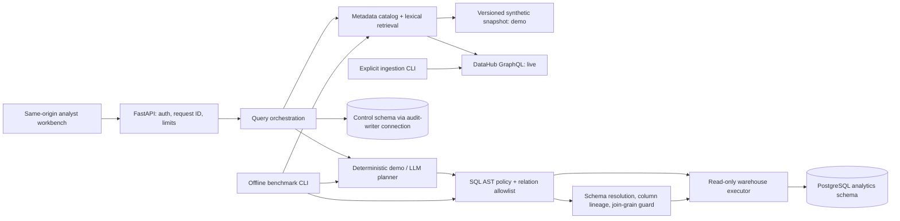

# Architecture

Status: implemented structure; integration and deployment verification are tracked in STATUS.md. Last updated: 2026-11-16.

## System

## Boundaries

The app is a modular monolith. `catalog.py` owns retrieval and the DataHub boundary; `planner.py` owns model I/O; `policy.py` validates untrusted SQL; `warehouse.py` owns constrained execution; `control.py` owns durable rate limits and audit events; `service.py` coordinates these boundaries. Routes do not directly issue warehouse SQL.

Production uses separate PostgreSQL roles: analytics reader, control writer, and an offline bootstrap owner. The application never receives bootstrap credentials. The warehouse reader has SELECT access in the curated analytics schema, defaults to read-only transactions, and is checked at readiness and before query execution. Generated SQL is restricted further to the approved table allowlist and cannot access the control schema. SQLite is a local demo/test implementation, not a production substitute.

## Query lifecycle

1. Authenticate; reject oversized requests; assign an opaque request ID.
2. Atomically consume a rate-limit slot in the control database; acquire a bounded process-local concurrency slot.
3. Load current metadata, retrieve relevant context, and record its source. Live metadata errors stop the request; there is no implicit fixture fallback.
4. Ask the planner for a typed answer, clarification, or refusal. Metadata and user text are untrusted prompt content.
5. Validate the generated SQL structurally: one read query, known relations/schema, no recursive CTEs, table functions, locking, mutations, or unapproved functions.
   Resolve columns and derive value lineage; reject the known raw financial one-to-many join pattern before execution. `/api/inspect` provides the same analysis and optional query-scoped schema-change impact without execution.
6. Execute with database read-only controls, statement/lock timeouts, and an outer result cap. SQLite additionally uses query_only, an authorizer, and a progress timeout.
7. Return SQL, rows, evidence, warnings, and a stage trace. Write a redacted audit record before releasing the result. An unavailable audit store fails closed.

## Data and semantics

Six tables: customers, products, orders, order_items, payments, refunds. No real PII. Money uses integer cents. Net revenue means completed-order line sales minus successful refunds, grouped by the order's date. Refunds are aggregated before joining; payments are not joined to line items for revenue calculations. The synthetic demo's reference date is explicit (2026-11-15), independent of the host clock.

## Deployment

Single ASGI worker initially; a process-local concurrency limit bounds model calls. Rate limits live in PostgreSQL and work across processes. Reverse proxy terminates TLS. Health endpoints distinguish liveness from readiness. Non-root container, pinned application dependency lock, no exposed warehouse port in production. API bearer authentication is single-owner access; multi-user identity/RBAC is a future, separate requirement.

The offline evaluator calls the same catalog, planner, policy, and executor components directly. It does not go through HTTP authentication, rate limits, or the production audit service. Its synthetic development questions are safe to include in a local report; real user questions remain redacted from runtime logs and audit storage.

## Deliberate limits

No arbitrary database connection input, uploaded SQL execution, autonomous writes, automatic metadata edits, or production data access. A SELECT parser alone is insufficient security. Snapshot evidence and deterministic demo results must never be represented as a live model benchmark. Result equivalence on synthetic fixtures is evidence within that benchmark, not proof of general SQL equivalence.

